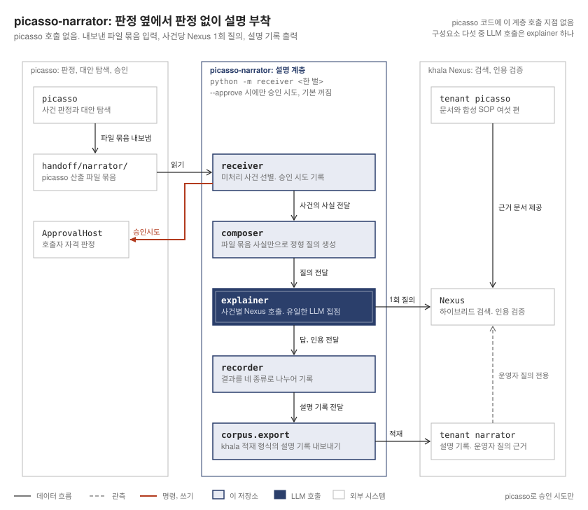

# picasso-narrator — 로봇 운영 사건을 근거와 함께 설명하는 계층

로봇 작업이 멈추면 운영자는 무엇이 관측되었고, 무엇을 아직 모르며, 어떤 절차를 확인해야 하는지 알아야 한다. **picasso-narrator는 이미 기록된 사건과 판정을 읽어 원인 후보와 대응 근거를 설명하는 LLM 계층 PoC다.**

실행 판정은 [picasso](https://github.com/LivingLikeKrillin/picasso)가, 운영과 자원 소유권은 [picasso-ops](https://github.com/LivingLikeKrillin/picasso-ops)가 맡는다. Narrator는 Khala/Nexus의 검색과 인용 검증을 활용하며, 답변·근거·미검증 주장을 구분하여 기록한다. **검증된 인용이 존재한다고 해서 원인 분석의 타당성까지 보장되는 것은 아니다.**

## 대표 시나리오

공유 스테이션에서 로봇 작업의 완료 근거가 불충분할 때 Ops는 스테이션 소유권을 유지하며 운영자 확인을 요청한다. Narrator는 Ops가 내보낸 판정·관측·이력 파일을 읽어 현재 확인 사유와 참고 절차를 설명한다. 설명 생성 성공 여부와 관계없이 이 경로는 자원을 해제하거나 작업을 재실행하지 않는다.

이 연동은 파일 기반으로 동작한다. Ops 화면 내 설명 자동 표시나 실물 설비와의 직접 연결은 현재 지원하지 않는다.

## 세 가지 사용 경로

| 입력 | 하는 일 | 판정과 실행의 책임 |
|---|---|---|
| picasso Incident Bundle | 사건별 원인 후보와 근거 설명을 기록 | picasso. 승인 시도는 명시적으로 활성화해야 하며 기본값은 비활성 |
| koshei 진단 요청 | picasso가 계산한 대응 후보 중 하나를 권고 | koshei 정책과 picasso 승인 자격. 정책 v1은 조치 자동 승인 비활성 |
| Ops `ops.station.evidence/1` 파일 | 공유 스테이션의 대기·확인 사유를 설명 | Ops. 이 설명 경로에는 상태 변경 API 호출이 없음 |

사건 파일 설명은 picasso가 내보낸 파일을 읽는 별도 경로에서 진행된다. **koshei 진단 워커는 Temporal 액티비티이므로 호출 워크플로가 응답을 기다린다.** 모든 경로에서 LLM 지연이 시스템에 무관하다고 간주해서는 안 된다. 논리적 시도는 단일 질의를 기준으로 하되, 경로마다 재시도 및 예약 규칙이 다르다.

<picture>
  <source media="(prefers-color-scheme: dark)" srcset="docs/diagrams/position.dark.svg">
  
</picture>

## 무엇이 다른가

| 설계 문제 | 구현과 검증 |
|---|---|
| LLM의 출력이 그대로 실행 명령이 됨 | 사전에 계산된 후보를 글자 별칭으로 제시하며 목록 밖 선택은 `OUT_OF_CANDIDATES`로 거부. [진단 계약 고정 예제](tests/fixtures/contract/diagnosis/README.md) |
| 근거 부족과 모델 오류를 구분 없이 처리함 | 설명 및 인용, 근거 부재, 인용 없는 답변, 생성 실패를 나누어 기록. [경계 규칙](BOUNDARY.md) |
| 동일 파일 재처리로 불필요한 질의가 반복됨 | 스테이션 원본 digest를 기준으로 생성 예약 및 결과 저장. 중단된 예약은 자동 재시도하지 않음. [구현 계획과 시험 범위](docs/superpowers/plans/2026-10-12-station-evidence.md) |
| 선별된 성공 사례만으로 품질을 주장함 | 답을 보기 전에 사례와 평가 기준을 고정하고 기준선과 실패 기록을 함께 보존. [평가 결과](eval/RESULTS.md) |

## 입력과 결과 예: 목록 밖 대응의 거부

[고정 요청 03](tests/fixtures/contract/diagnosis/requests/03-out-of-candidates.json)은 `CHOOSE_SOURCE`와 `ESCALATE` 후보를 포함한다. 모의(대역) 응답이 목록에 없는 대상을 선택했을 때 현재 진단 함수가 생성한 [응답 03](tests/fixtures/contract/diagnosis/responses/03-out-of-candidates.json)의 일부는 다음과 같다.

```json
{
  "contractVersion": "0.6",
  "outcome": "OUT_OF_CANDIDATES",
  "candidateId": null,
  "picked": "SEQ-IN-05.BIN-A 로 옮겨 집는다"
}
```

이 예시는 **고정 대역 답변에 대한 결정적 처리 결과**이며, 실제 모델의 생성 품질을 측정한 사례가 아니다. `tests/test_contract_fixtures.py`가 현재 함수의 결과와 고정 파일을 대조한다. 원문 응답에는 검증하지 못한 인용도 별도 목록으로 보존된다.

## 실행 및 테스트

Python 3.11 이상이 필요하다. 저장소 루트에서 의존성을 설치하고 테스트를 실행한다.

```bash
python -m pip install -e ".[dev]"
PYTHONIOENCODING=utf-8 python -m pytest -q
```

기본 시험은 픽스처를 사용하며 Nexus 서버 없이 실행한다. Temporal 워커 의존성을 설치하려면 `python -m pip install -e ".[dev,worker]"`를 사용한다. 2026-10-12 로컬 검증 결과는 **391 passed, 10 deselected**였으며, `temporalio`가 없으면 워커 관련 시험이 건너뛰어질 수 있다. 실제 서비스 시험은 `live` 마커로 분리한다.

실제 설명 생성에는 별도의 Khala/Nexus 서비스와 `NEXUS_TOKEN` 환경 변수가 필요하다. 서비스 준비는 [현재 상태](STATE.md)를 따른다. 아래 명령은 오프라인 데모가 아닌 실제 서비스 호출 명령이다.

```bash
# 사건 번들을 읽어 설명을 파일로 기록한다. 승인 시도는 기본 꺼짐.
python -m receiver tests/fixtures/picasso/run-1 --out out

# Ops에서 내보낸 공유 스테이션 근거 파일을 설명한다.
python -m receiver.station station-evidence.json --out out/stations --nexus-url http://localhost:8000 --tenant picasso

# Temporal 서버와 worker 의존성이 필요한 진단 워커
python -m diagnose.worker
```

스테이션 근거 파일은 `ops.station.evidence/1` 형식이어야 한다. 결과는 `narrator.station.explanation/1` 파일로 저장하며 원본 digest와 판정 버전을 함께 기록한다.

외부 서비스 연결 없이 지난 측정 결과를 확인하려면 아래 리플레이 명령을 실행한다. 새 모델 응답이나 새 점수를 만드는 명령은 아니다.

```bash
python eval/replay.py --show G3 S1 Q3
```

## 검증 현황과 해석 범위

⛔ **실제 서비스 연결과 모델 품질은 별개다 (2026-10-04).** koshei 에피소드 → Temporal 진단 워커 → Khala/Nexus → koshei 판정까지 1회 실행 검증했다. 진단 소요 시간은 255.5초였고 권고는 `ESCALATE`, 에피소드 결과는 `ESCALATED`였다. 인용 13개가 검증되었으나 단 한 번의 성공으로 지연 시간, 품질, 시스템 안정성을 일반화할 수 없다.

모델 실험의 설정, 표본, 기준선, 실패 기록은 [평가 결과](eval/RESULTS.md)에 보관한다. 합성 SOP와 데모 규모 사례를 사용했으며 실물 로봇에 연결하지 않았다. README의 픽스처 시험 통과 수와 실제 서비스 측정의 품질 수치는 서로 다른 증거다.


## 중요한 한계

- 근거 출처의 코드 검증이 원인 추론의 정확성이나 절차의 현장 적합성을 보장하지는 않는다.
- 스테이션 설명은 파일 입력 및 파일 출력으로만 동작한다. Ops UI 자동 표시, 자원 해제, 재실행, 안전 제어 기능은 제공하지 않는다.
- 생성 예약 후 중단된 스테이션 설명은 자동으로 재시도되지 않는다. 중복 질의 방지가 생성 완료를 보장하지는 않는다.
- 사건 설명 경로에는 명시적으로 활성화할 수 있는 승인 시도 기능이 있다. 자격 판정은 picasso가 담당하며, 스테이션 설명 경로에는 이 호출 자체가 없다.
- koshei 진단 호출은 응답을 기다리며 모델 지연과 실패의 영향을 받는다. 운영 경로별 세부 처리는 [SEQUENCES.md](SEQUENCES.md)를 따른다.
- 추가 실험 없이 과거 결과를 최신 모델 성능으로 해석하지 않는다. 사후 결과에 맞춰 평가 기준과 정답 데이터를 임의로 변경하지 않는다.

## 문서

| 문서 | 내용 |
|---|---|
| [STATE.md](STATE.md) | 현재 구현·서비스 상태와 미결 항목 |
| [BOUNDARY.md](BOUNDARY.md) | 책임 경계·승인 자격·근거 분류 기준 |
| [SEQUENCES.md](SEQUENCES.md) | 운영 경로별 호출과 대기 관계 |
| [진단 계약](docs/superpowers/specs/2026-09-27-진단-계약-초안.md) | 요청·응답 규격과 권고 결과 |
| [고정 예제](tests/fixtures/contract/diagnosis/README.md) | 요청 출처와 대역 답변의 한계 |
| [평가 설계](eval/README.md) · [평가 결과](eval/RESULTS.md) | 평가지표·기준선·실행 기록·정정 내역 |
| [코퍼스 내보내기](corpus/README.md) | 설명 기록 적재 형식 |
| [사건 인계 픽스처](tests/fixtures/picasso/README.md) | picasso 번들 출처 |
| [스테이션 설명](docs/superpowers/plans/2026-10-12-station-evidence.md) | Ops 파일 계약·중복 질의 방지 설계 |

> 마지막 갱신: 2026-10-12 · 파일 기반 스테이션 설명과 진단 경로의 대기 관계를 구분
